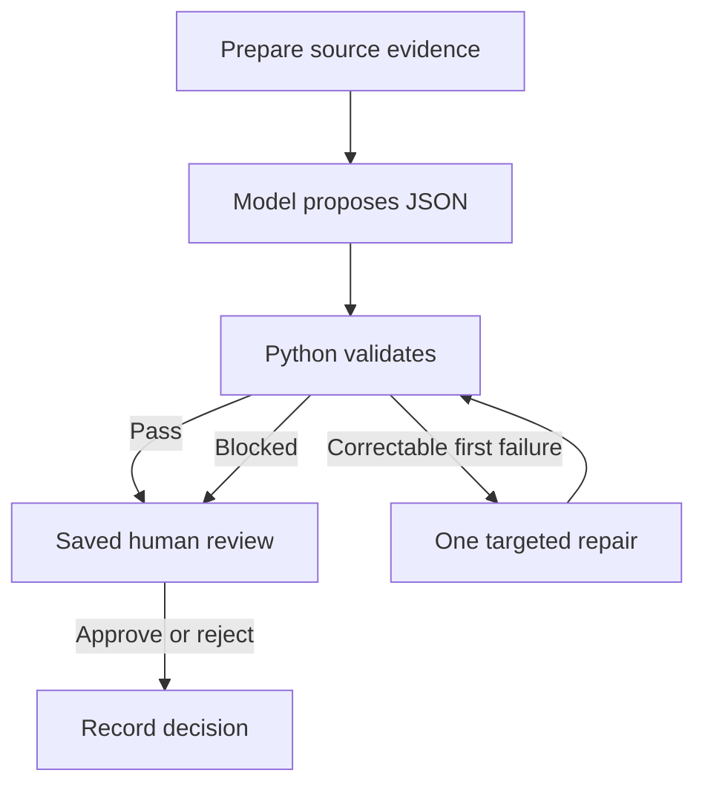

# Reconciliation Agent Lab

An independent Python prototype that investigates exposure differences, proposes
evidence-backed explanations, and escalates unresolved cases. It uses synthetic
transactions and procedures. Developed with AI assistance, with explicit workflow
design, trace inspection, validation and evaluation.

**Stack:** Python, LLM APIs through OpenRouter, LangChain, LangGraph, Chroma,
local MiniLM embeddings, SQLite, structured JSON and automated tests.

## The problem

An aggregate balance comparison is not sufficient to reconcile two populations.
The prototype distinguishes a supported timing difference, alternate identifiers
for the same deal, and misleading similarities between different deals.

| Synthetic case | Correct outcome | Required distinction |
| --- | --- | --- |
| C001 | EXPLAINED / TIMING | An A-only booked exposure has current pending-settlement evidence |
| C002 | EXPLAINED / ALTERNATE_ID | Different source IDs have current links to the same economic deal |
| C003 | ESCALATE / DIFFERENT_DEALS | Equal totals conceal different deals; INR 75,000 remains unresolved on each side |

## Implemented approaches

| Files | Capability |
| --- | --- |
| 01-03 | Raw model requests, handwritten tool loop, then a LangChain agent |
| 04-06 | Local Chroma indexing, versioned procedure retrieval and grounded answers |
| 07-09 | Explicit LangGraph execution, SQLite checkpoints, human review and source investigation |
| 10 | Main investigator delegating procedure interpretation to an isolated policy specialist |
| 11 + reconciliation_core.py | Prepared evidence, one structured proposal, independent Python validation and bounded repair |

The numbered scripts remain together because later lessons import earlier ones.
The RAG/specialist approaches are working stages of the project. The final small
workflow supplies all seven short rules directly and does not use retrieval or
specialist calls. This makes the final architecture simpler without suggesting
that every task benefits from RAG or delegation.

## Final workflow



Python calculates balances, gathers current evidence and checks the model's
record-level proposal against the supplied v1 rules. A correctable response may
receive one repair request. Transport/output-limit failures stop without blind
retries. SQLite preserves the review pause; status/resume do not call a model.
Unvalidated proposals cannot be approved. Approval never edits transaction data.

Application state and model context are separate. Each request receives only
the selected evidence, rules and instructions; saved audit history is not
automatically appended. The specialist version bounds its input and output.

## Observed results

One user-provided live run, dated 2026-10-12, used the fixed model
`nvidia/nemotron-3-ultra-550b-a55b:free`:

| Case | Structured checks | Requests | Input tokens | Output tokens |
| --- | --- | ---: | ---: | ---: |
| C001 | PASS | 1 | 2,483 | 1,815 |
| C002 | PASS | 1 | 2,178 | 918 |
| C003 | PASS | 1 | 2,172 | 1,039 |

All three passed their intended structured checks on the first attempt, with
no repairs. The summary in [examples/final3-summary.json](examples/final3-summary.json)
is transcribed from the supplied terminal output, not exported raw API reports.
Human review was pending in that output. The original reports remain on the
developer's machine; reviewers can reproduce a fresh run using their own key.

The original specialist trace used 18 requests for C001. The final architecture
used one in the observed run, but different models and workflows make this an
architectural observation, not a controlled performance benchmark.

## Run without model credits

Python 3.12 is the validated packaging environment. From the project folder:

```bash
python3 -m venv .venv
source .venv/bin/activate
python3 -m pip install -r requirements-core.txt
python3 check_fixtures.py
python3 test_final_workflow.py
```

The fixture checker verifies data/answer-key consistency. The 20 offline tests
use simulated model replies while exercising the real validator, graph and
SQLite persistence. They check malformed output, unsupported matches/timing,
missing/stale evidence, source changes, bounded repair and review in new processes.
Passing these tests does not evaluate live model reasoning.

## Run the final model evaluation

```bash
cp .env.example .env
```

Set your own `OPENROUTER_API_KEY` in the local .env. The model shown below is the
one used in the recorded run; availability and free-service limits may change.

```bash
python3 11_optimized_workflow.py evaluate --run demo-1 --model nvidia/nemotron-3-ultra-550b-a55b:free
python3 11_optimized_workflow.py status --run demo-1
```

Inspect the proposals and evidence in reports/. After reviewing them:

```bash
python3 11_optimized_workflow.py resume --run demo-1 --decision approve
```

For a detailed no-request preview:

```bash
python3 11_optimized_workflow.py start --case C001 --preview --show-context
```

## Run the retrieval and specialist lessons

```bash
python3 -m pip install -r requirements.txt
python3 04_retrieval.py build
python3 04_retrieval.py search "What evidence supports a timing explanation?"
python3 05_rag_answer.py
python3 10_specialist_agent.py start --case C001
```

The first index build downloads a local embedding model. These earlier model
lessons require a configured API key. [LAB_GUIDE.md](LAB_GUIDE.md) describes the
progression; [FINAL_GUIDE.md](FINAL_GUIDE.md) explains the final implementation.

## Evaluation boundaries

The evaluator reads evaluation/expected_results.json only after model execution.
The model, tools and independent validator do not consult that answer key.
Structured checks verify amounts, identities, evidence/reference presence and
disposition; unrestricted prose/citation support still needs human review.

This is a local prototype tested on three known synthetic cases, not a production
banking control or a reconstruction of employer infrastructure. The final
validator implements the frozen supplied v1 procedures, not arbitrary new rules.
Changing those procedures requires updating and retesting its implementation.

## Useful files

- `11_optimized_workflow.py`: final entry point, model requests, graph, reports and evaluation.
- `reconciliation_core.py`: source preparation, contract/parser and independent rule checks.
- `test_final_workflow.py`: offline mechanism tests.
- `data/` and `procedures/`: synthetic source inputs and versioned policies.
- `examples/`: explicitly labeled observed result summary.
- `.github/workflows/offline-checks.yml`: fixture and offline test workflow; no model credentials.
